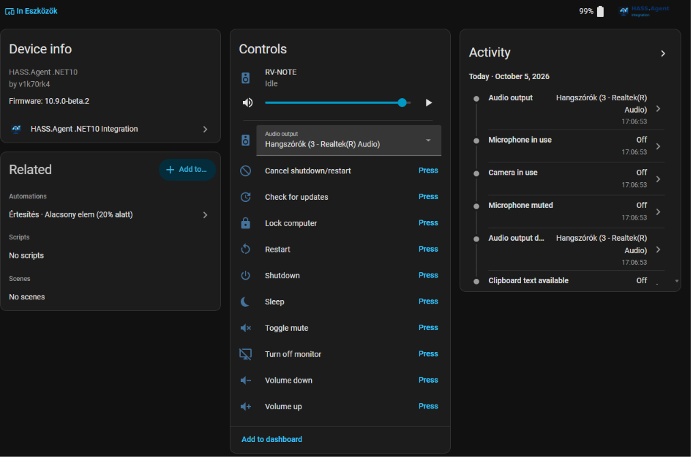
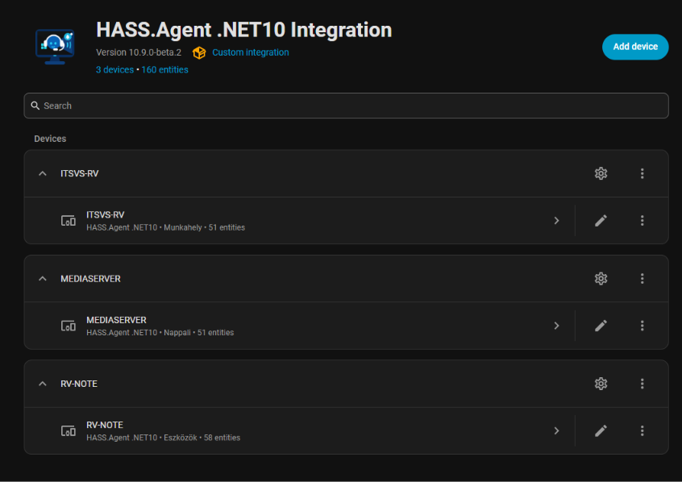
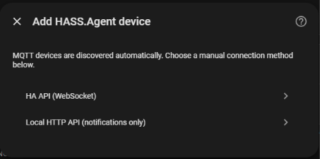
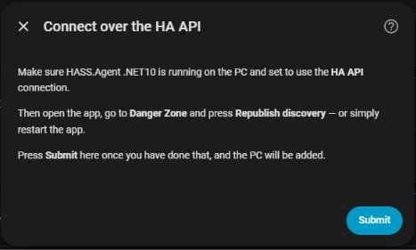
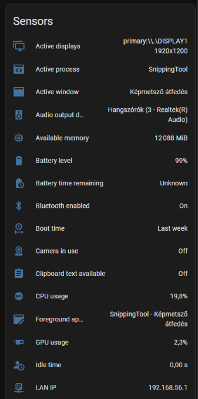
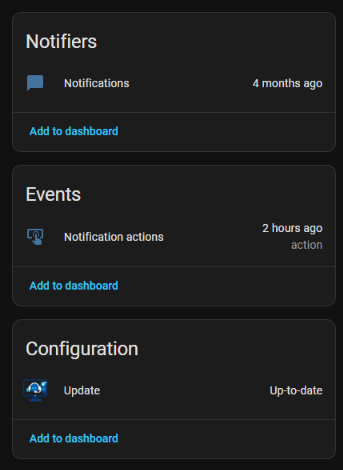
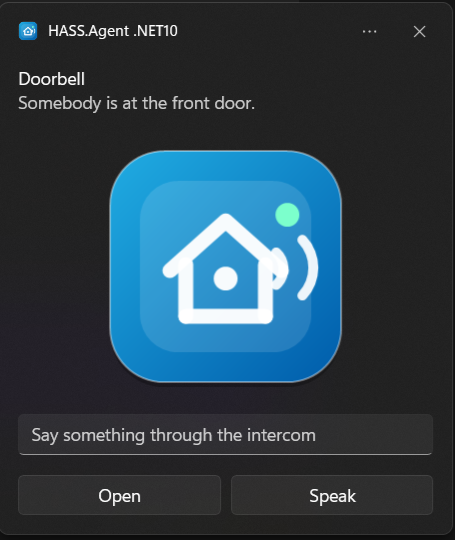
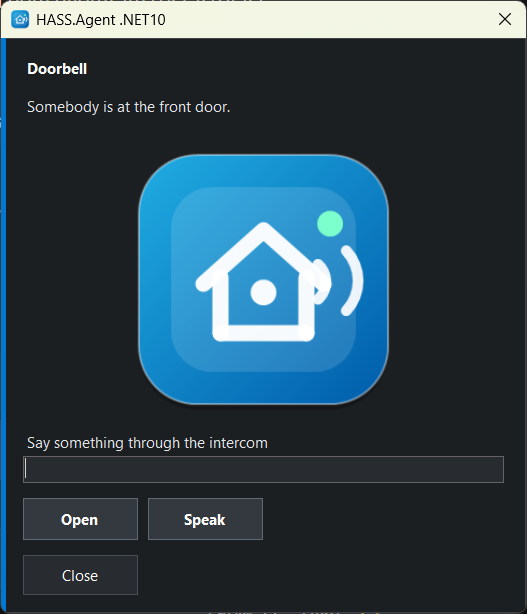

<p align="center">
  
</p>

<p align="center">
  <a href="https://github.com/v1k70rk4/HASS.Agent.NET10-Integration/releases/latest"></a>
  
  
  <a href="https://github.com/v1k70rk4/HASS.Agent.NET10"></a>
  
  <a href="https://www.bestpractices.dev/projects/15364"></a>
  <a href="https://scorecard.dev/viewer/?uri=github.com/v1k70rk4/HASS.Agent.NET10-Integration"></a>
  <a href="https://ko-fi.com/v1k70rk4"></a>
</p>

Custom Home Assistant integration for HASS.Agent devices.

This integration exposes a Windows HASS.Agent device as Home Assistant entities. Devices can connect through MQTT or Home Assistant's WebSocket API (HA API). Notification actions are exposed both as device automation triggers and as a modern Home Assistant event entity.

It is the matching Home Assistant side for the modern **HASS.Agent .NET10** Windows client.

> ⭐ **Enjoying it?** Please star this repo — and the [Windows app](https://github.com/v1k70rk4/HASS.Agent.NET10) too. It helps others find the project and keeps it going!
>
> ☕ If it saved you an evening of tinkering, you can [buy me a coffee on Ko-fi](https://ko-fi.com/v1k70rk4). Everything stays free — it just helps cover things like the code signing certificate for the Windows app.

---

> **Important**: This integration (v10.0.0+) requires **[HASS.Agent .NET10](https://github.com/v1k70rk4/HASS.Agent.NET10)** as the Windows client. The older pre-.NET10 HASS.Agent client is **not compatible** with this version: if one is detected it is not added, and a notice appears under **Settings → Repairs**. A HASS.Agent .NET10 older than the minimum below is added, with a notice to update it.
>
> The HA API WebSocket transport requires HASS.Agent .NET10 v10.2.0 or newer.
>
> If you want to keep using the old HASS.Agent client, switch to the **[`legacy` branch](https://github.com/v1k70rk4/HASS.Agent.NET10-Integration/tree/legacy)** of this integration. The legacy branch works with Home Assistant 2026.6+ and the original pre-.NET10 HASS.Agent, but it is **no longer maintained**.

> **Stable:** [10.13.0](https://github.com/v1k70rk4/HASS.Agent.NET10-Integration/releases/latest) &nbsp;·&nbsp; **Beta:** [10.13.1-beta.1](https://github.com/v1k70rk4/HASS.Agent.NET10-Integration/releases/tag/v10.13.1-beta.1) &nbsp;·&nbsp; [What changed](#changelog) &nbsp;·&nbsp; [Full changelog](https://github.com/v1k70rk4/HASS.Agent.NET10-Integration/blob/main/CHANGELOG.md)

<p align="center"></p>

---

## Installation

### Requirements

| Component | Minimum version |
|-----------|----------------|
| Home Assistant | 2026.6.0 |
| HASS.Agent .NET10 (Windows client) | 10.2.0 (10.9.1+ recommended) |
| MQTT broker (recommended) | Mosquitto or any MQTT 3.1.1+ broker |

This integration is in the **Marketplace** (HACS in Home Assistant before 2026.11), so no custom repository needs to be added. On Home Assistant 2026.6 to 2026.10 install [HACS](https://hacs.xyz) first; from 2026.11 the Marketplace is built in and HACS is not needed.

The Windows client installs with winget, or with the signed installer from its [Releases](https://github.com/v1k70rk4/HASS.Agent.NET10/releases/latest):

```powershell
winget install v1k70rk4.HASSAgentNET10
```

MQTT is recommended for full functionality. Alternatively, HA API (WebSocket) provides nearly the same features without requiring an MQTT broker. The Local HTTP API setup supports notifications only.

### Install from the Marketplace

This integration is in the **Marketplace** — no custom repository needed.

[](https://my.home-assistant.io/redirect/hacs_repository/?owner=v1k70rk4&repository=HASS.Agent.NET10-Integration&category=integration)

1. Open **Settings → Marketplace** (HACS in the sidebar before 2026.11) and search for **HASS.Agent** — or click the button above.
2. **Download** the integration.
3. **Restart** Home Assistant.
4. **Add the integration** — click the button below (or go to **Settings → Devices & services → Add integration → HASS.Agent**):

   [](https://my.home-assistant.io/redirect/config_flow_start/?domain=hass_agent)

   With MQTT enabled in the Windows client, the PC turns up on its own under **Discovered** at the top of **Settings → Devices & services**. Like any Home Assistant discovery it waits for you: click **Add** on that card to create the device and its entities.

   Over the HA API (WebSocket) the **first** PC is added by hand, here, with **HA API (WebSocket)**: Home Assistant only lets an integration listen for new devices once it has one. Every further PC on the HA API is then discovered like the MQTT ones. For the Local HTTP API you always add it manually here.

If another HASS.Agent integration is already installed, remove it before installing this one, then restart Home Assistant.

Every PC is a device of the integration. **Add device** is for the two ways that are not discovered on their own:

<p align="center"></p>
<p align="center"></p>

---

## Features

- MQTT auto-discovery for HASS.Agent .NET10 devices
- Media player entity for playback control, volume control, media browsing, TTS, and album art
- Notify entity for sending notifications to the Windows client
- Notification action triggers for automations
- Notification action event entity for newer Home Assistant automation workflows
- Button entities for Windows commands: lock, sleep, monitor off, volume, shutdown, restart, restart cancel
- Custom command button entities: user-defined programs, PowerShell scripts, key presses, links and popup windows advertised by the Windows client
- System sensor entities for Windows machine state (CPU, memory, disk, battery, network, session, etc.)
- Custom sensor entities: process running, service status, disk free, built-in attribute extraction, command output, LibreHardwareMonitor values
- Dynamic sensor handling based on what the Windows client advertises
- Automatic removal of disabled command and sensor entities
- Service-aware command routing for system commands handled by the Windows service
- HA API WebSocket failover transport for device, sensor, media, and notification action events
- Serial-number based MQTT topic and HA API command routing
- `hass_agent.execute_command` service for scripts and automations
- With the client 10.9.0 or newer: the PC's display as a light, select entities for the default audio output and input device, a *Hotkeys* event entity, and the `hass_agent.set_app_volume` service
- Local HTTP API setup for notification-only use cases (with API key authentication)
- Hungarian and English translations

## Connection Modes

### MQTT (recommended)

Enable MQTT in the HASS.Agent .NET10 Windows client. The device is discovered automatically in Home Assistant. All features work:

- Notifications (with actionable buttons)
- Media player (play/pause, volume, TTS)
- System sensors (built-in + custom)
- Command buttons (lock, shutdown, restart, etc.)
- Update entity
- Windows service integration
- Retained state on restart
- Last Will (automatic offline detection)

### HA API (WebSocket)

The Windows client connects directly to Home Assistant's WebSocket API using a long-lived access token. Works remotely (e.g. via Nabu Casa) without an MQTT broker. Can be used standalone or as automatic failover when the MQTT broker is unreachable.

From 10.9.1 (integration and client) the token does not have to be an administrator's: the client offers to create a Home Assistant user of the PC's own, who is not an administrator and has no password, and the integration only lets that user speak for its own PC. See [A Home Assistant user for the PC](https://github.com/v1k70rk4/HASS.Agent.NET10/blob/main/docs/connection.md#a-home-assistant-user-for-the-pc).

The first PC that uses the HA API is added by hand: choose **Add integration → HASS.Agent** (or **Add device** on the integration's page) **→ HA API (WebSocket)**, and follow the dialog. It waits for the client's announcement, which the client sends when it connects and when you press **Republish discovery** in its Danger Zone. Once the integration has a device, further PCs on the HA API turn up under **Discovered** on their own.

<p align="center"></p>

Nearly all features work — notifications, media player, sensors, commands — with some trade-offs compared to MQTT:

- No retained state (sensor values are lost until the agent reconnects after a restart)
- No Last Will (no automatic offline detection)
- Media thumbnails are ~33% larger (base64 encoding)
- HTTPS is required for remote access

The Windows service takes part on this transport too (client 10.6.5+): it announces itself on its own event, and command buttons are routed to the app or the service exactly as they are over MQTT.

The client communicates through Home Assistant's event bus:

```text
hass_agent_device_update          # discovery + capabilities (tray app)
hass_agent_service_update         # Windows service status + capabilities
hass_agent_update_state           # available app update (drives the update entity)
hass_agent_sensor_update          # sensor values
hass_agent_media_update           # media player state
hass_agent_media_thumbnail        # media album art (base64)
hass_agent_notification_action    # notification button press
hass_agent_hotkey                 # hotkey press (client 10.9.0+)
```

All events and commands are targeted by `serial_number`, so renaming a device in Home Assistant does not break command delivery.

### Local HTTP API

A minimal fallback for environments where neither MQTT nor HA API is available. On a new install of the agent (10.9.3 and newer) the API is off: turn it on first on its **General** page, under **Local HTTP API**. Then add the device manually:

- **Host**: the Windows machine's LAN IP address
- **Port**: `5115` (default)
- **SSL**: disabled
- **API key**: copy from the agent's General settings page (Local HTTP API section); it is made when the API is turned on, and a new one each time it is turned on again

Only notifications are supported. The `POST /notify` endpoint is protected with the API key (`Authorization: Bearer <key>`). Use MQTT or HA API for full functionality.

## Entities

When connected via MQTT or HA API, the integration creates the following entities:

| Platform | Entity | Description |
|----------|--------|-------------|
| `media_player` | Media player | Control Windows media playback, volume, cover art, TTS and announcements |
| `notify` | Notifications | Send notifications to the Windows tray |
| `event` | Notification actions, Hotkeys | Action button press events from notifications; hotkey presses (client 10.9.0+) |
| `sensor` | System sensors | Built-in and custom sensors from the Windows client |
| `button` | System commands | Lock, sleep, shutdown, restart, volume, etc. |
| `select` | Audio output / input | Chooses the default playback and recording device (client 10.9.0+, the matching *Audio output device* / *Audio input device* sensor enabled) |
| `light` | Display | Screen brightness where the display can be dimmed; off switches the monitor off, on wakes it (client 10.9.0+, *Display brightness* sensor enabled) |
| `image` | Screenshot | The last screenshot of the PC, taken when its *Take a screenshot* button is pressed and never on its own (client 10.13.1+, the command ticked on the PC; it is off by default) |
| `update` | App update | Shows available HASS.Agent .NET10 updates |

Entities are created and removed dynamically as the Windows client changes its configuration.

<p align="center"> </p>

### Turning the PC on and off with the media player

Off by default (10.10.0+, any supported client). Turn it on in the integration's options: **Settings → Devices & services → HASS.Agent .NET10 → Configure** on the PC, then **Media player: turn on and off**. It is not switched on by itself because it changes the player's state: until now a PC whose app was not running made the player *unavailable*, and automations may count on that.

With the option on:

- **The player is *off* when the PC is off**, not unavailable, so it can be turned on. While the Windows service still reports, the PC is on and only the app is closed: the player stays unavailable then. That can be switched off with **Media player: unavailable while the Windows service still reports**; without the service the PC cannot tell the two apart and the player is off.
- **Turn on** fires the device trigger *Turn on was requested (media player)* and runs the script picked under **Media player: script to run on turn on**, if any. A PC that is off cannot be reached, so the waking is yours: Wake on LAN, a smart plug, anything an automation or a script can do.
- **Turn off** fires the device trigger *Turn off was requested (media player)*, then does what **Media player: turn off does** says: nothing, the script picked under **Media player: script to run on turn off**, or the PC's own *Sleep*, *Hibernate* or *Shutdown* command. Shutdown waits 60 seconds, like the button, and the command has to be switched on in the Windows app.

The scripts get `serial_number`, `device_id` and `entity_id` as variables. Waking a PC with Wake on LAN:

```yaml
script:
  wake_my_pc:
    sequence:
      - action: wake_on_lan.send_magic_packet
        data:
          mac: "AA:BB:CC:DD:EE:FF"
```

### A power switch for the PC

For a switch on a dashboard instead of a media player, or a PC that has the media player switched off, make one with Home Assistant's **Template** helper: **Settings → Devices & services → Helpers → Create helper → Template → Switch**. The integration does not create one, because what *on* means is yours to say: the app reporting, the Windows service reporting, the PC answering a ping, or the smart plug it hangs on drawing power. A ping or a plug tells whether the machine is powered, not whether the app runs, which is the more honest answer for a power switch. In YAML:

```yaml
template:
  - switch:
      - name: "My PC power"
        state: "{{ is_state('binary_sensor.my_pc_ping', 'on') }}"
        turn_on:
          action: script.wake_my_pc
        turn_off:
          action: button.press
          target:
            entity_id: button.my_pc_shutdown
```

The shutdown button is there when *Shutdown* is switched on in the Windows app under **Capabilities → System commands**; `button.my_pc_sleep` or `button.my_pc_hibernate` work the same way, if those are switched on. To go by the PC's own report, use `{{ has_value('sensor.my_pc_uptime') }}` as the state, with a sensor ticked for the Windows service on the **Capabilities** page, so it stays on while nobody is logged in. A PC takes a while to boot after the switch is turned on, and the switch shows off until the state says otherwise; that is the state being right, not the wake failing, so give it time before turning it on again.

### Announcements

A `media_player.play_media` action sent with `announce: true` (a TTS message, `tts.speak` with `media_player_entity_id`, a doorbell sound) is meant to be heard. With the Windows client **10.9.3** or newer the PC is unmuted and set to the announcement volume chosen on its **Media player** page for it, what was playing is paused when the user wants that, and afterwards the volume, the mute and the playback go back to what they were. An older client plays the sound at the current volume, as before; without the flag, so does every client.

## Services

### hass_agent.send_notification

Sends a notification to a HASS.Agent notify entity, with an optional picture, buttons and text fields. The PC shows it as a Windows notification or in the client's own window:

<p align="center"> </p>

With buttons only:

```yaml
action: hass_agent.send_notification
target:
  entity_id: notify.my_pc_notifications
data:
  message: "Would you like to turn on the lights?"
  title: Home Assistant
  actions:
    - action: lights_on
      title: "Turn on"
    - action: lights_off
      title: "Turn off"
```

Besides `message` and `title`, the action has these fields; in the Home Assistant editor each has an input of its own:

| Field | Description |
|-------|-------------|
| `actions` | Buttons, each with an `action` (what comes back) and a `title`. Up to five. |
| `image` | A picture: a web address, a path on this Home Assistant (`/local/doorbell.jpg`, `/api/camera_proxy/camera.front_door`), or a camera or image entity (`camera.front_door`). A path or an entity is signed for five minutes so the PC can fetch it; only paths under `/local/`, `/media/` and the camera and image proxies are (10.9.1+), anything else is left out. Client 10.9.0+. |
| `inputs` | Text fields, each with an `id` and a `title` (the hint in the empty field). Up to five. What was typed comes back with the pressed button, in `input`, by id. Client 10.9.0+. |
| `duration` | Seconds on screen, 1 to 60 (default 10). |
| `style` | `toast` (a Windows notification) or `window` (the client's own always-visible window), for this one notification. Without it the client's own setting decides. Client 10.9.0+. |

> `image`, `inputs` and `style` need the integration and the client 10.9.0 or newer. An older client shows the notification without them.

```yaml
action: hass_agent.send_notification
target:
  entity_id: notify.my_pc_notifications
data:
  title: Doorbell
  message: "Somebody is at the front door."
  image: camera.front_door
  style: window
  inputs:
    - id: answer
      title: "Say something through the intercom"
  actions:
    - action: speak
      title: "Speak"
```

Before 10.9.0 these fields had to be given inside a `data` object of the action (`data:` → `data:` → `actions:`). That still works, so existing automations need no change; a field given on its own wins over the same key in `data`.

The press arrives on the device's *Notification actions* event entity and as a `hass_agent_notifications` event, with the typed text in `input`:

```yaml
action: speak
input:
  answer: "Leave it at the door, please"
device_name: MY-PC
```

### hass_agent.execute_command

Sends a system command to a HASS.Agent .NET10 device:

| Field | Required | Description |
|-------|:--------:|-------------|
| `device_name` | yes | Target Windows device name |
| `command` | * | `lock`, `sleep`, `hibernate`, `logoff`, `monitor_off`, `volume_up`, `volume_down`, `toggle_mute`, `shutdown`, `restart` |
| `comment` | | Windows shutdown/restart comment |
| `force` | | Force shutdown/restart (default: `false`) |
| `time` | | Delay in seconds (default: `0`) |
| `restart_cancel` | * | Cancel a pending shutdown/restart |

\* Either `command` or `restart_cancel: true` is required.

Example:

```yaml
action: hass_agent.execute_command
data:
  device_name: MY-PC
  command: restart
  force: true
  time: 30
  comment: "Restarted from Home Assistant"
```

Cancel a pending shutdown or restart:

```yaml
action: hass_agent.execute_command
data:
  device_name: MY-PC
  restart_cancel: true
```

When the Windows service is online and capable of handling the command, the integration automatically routes it to the service topic. Otherwise it falls back to the tray app.

### hass_agent.set_app_volume

> Needs the Windows client 10.9.0 or newer with its *Audio sessions* sensor turned on.

Sets the volume of one app in the Windows volume mixer, or mutes it. The *Audio sessions* sensor lists the apps with their volumes as attributes.

| Field | Required | Description |
|-------|:--------:|-------------|
| `device_name` | yes | Target Windows device name |
| `app` | yes | The app as the *Audio sessions* sensor names it, e.g. `spotify` |
| `volume` | * | Volume in percent, `0` to `100` |
| `muted` | * | `true` to mute, `false` to unmute |

\* At least one of `volume` and `muted` is required; both can be given in one call.

```yaml
action: hass_agent.set_app_volume
data:
  device_name: MY-PC
  app: spotify
  volume: 30
```

## MQTT Topics

Published by the Windows client, consumed by this integration:

```text
hass.agent/devices/{serialNumber}                # discovery + capabilities
hass.agent/system/{serialNumber}/state           # Windows service status
hass.agent/sensors/{serialNumber}/state          # sensor values
hass.agent/update/{serialNumber}/state           # app update state
hass.agent/media_player/{serialNumber}/state     # media player state
hass.agent/notifications/{serialNumber}/actions  # notification action events
hass.agent/hotkeys/{serialNumber}/pressed        # hotkey presses (client 10.9.0+)
```

Published by this integration (commands):

```text
hass.agent/notifications/{serialNumber}          # outgoing notifications
hass.agent/media_player/{serialNumber}/cmd       # media player commands
hass.agent/buttons/{serialNumber}/cmd            # system command buttons
hass.agent/system/{serialNumber}/cmd             # service-routed commands
```

## Home Assistant Events

When using the HA API (WebSocket) transport, the Windows client fires events into Home Assistant's event bus instead of MQTT topics (see [HA API (WebSocket)](#ha-api-websocket) above). The integration also sends commands back to the client through the `hass_agent_command` event:

```json
{
  "serial_number": "device-serial-number",
  "command_type": "button_command",
  "payload": {
    "command": "restart",
    "force": true,
    "time": 30
  }
}
```

A hotkey pressed on the PC (client 10.9.0+) reaches the device's *Hotkeys* event entity on either transport, and the entity fires `hass_agent_hotkey_pressed` on the event bus with the hotkey's name in `hotkey`.

When a PC offers a new HASS.Agent version, the integration (10.13.0+) fires `hass_agent_update_available` once for that version, with `device_name`, `serial_number`, `installed_version`, `latest_version` and `release_url`. It remembers which version it announced, across restarts of Home Assistant and of the PC: the same update is not announced again, and one that came out while the PC was off is announced when the PC is back. The device trigger *A new HASS.Agent version is available* is the same event for one PC. The update entity's state can't tell these cases apart, since it comes back `unknown` and then `on` after every restart, so an automation that should speak up once per version is better on the event:

```yaml
triggers:
  - trigger: event
    event_type: hass_agent_update_available
    event_data:
      device_name: MY-PC
actions:
  - action: notify.notify
    data:
      message: "{{ trigger.event.data.device_name }}: HASS.Agent {{ trigger.event.data.latest_version }} is out"
```

The first time the integration runs with this, an update a PC already offers is announced once.

---

## Changelog

### 10.13.1-beta.1

> **Beta.** Going with the Windows client [10.13.1-beta.1](https://github.com/v1k70rk4/HASS.Agent.NET10/releases/tag/v10.13.1-beta.1): the PC's screenshot as an image entity, and an update event that carries only what reads as a version. Works with every supported Windows client. In the Marketplace (HACS in Home Assistant before 2026.11): open the integration, choose **Redownload**, turn on **Show beta versions**, then pick **10.13.1-beta.1**. Restart Home Assistant afterwards.

- **The PC's screenshot, as an image entity.** A PC whose tray app has the *Take a screenshot* command ticked (Windows client 10.13.1-beta.1 or newer; it is off by default and can only be turned on at the PC) gets a **Take a screenshot** button and a **Screenshot** image. The PC takes a picture only when the button is pressed, never on its own; for one at regular times, press the button from an automation. The picture is kept in memory only: after a restart of Home Assistant there is none until the next one is asked for. Over the HA API it comes through a command of its own and not as an event, so it is not on Home Assistant's event bus. Unticked on the PC, both entities go. See [Screenshot](https://github.com/v1k70rk4/HASS.Agent.NET10/blob/main/docs/commands/screenshot.md).
- **The update event carries only what reads as a version.** `hass_agent_update_available` took the version from the PC's update state as it came, so a text of any length went into the event and into the file that keeps what was announced. Now only a version does: two to four numbers, with the `v` of a release's tag before them and a short part after a dash or a plus. The installed version is left out of the event when it is not one. The update entity shows what the PC sends, as before.

### 10.13.0

Going with the Windows client [10.13.0](https://github.com/v1k70rk4/HASS.Agent.NET10/releases/tag/v10.13.0): an event when a PC offers a new version, an update entity that no longer says "update available" for a moment while the PC comes back, and a limit on approval requests. Works with every supported Windows client. Update in the Marketplace (HACS in Home Assistant before 2026.11) and restart Home Assistant afterwards.

- **An event when a PC offers a new HASS.Agent version.** `hass_agent_update_available` fires once for that version, with `device_name`, `serial_number`, `installed_version`, `latest_version` and `release_url`; the device trigger *A new HASS.Agent version is available* is the same event for one PC. The integration remembers which version it announced, across restarts of Home Assistant and of the PC: the same update is not announced twice, and one that came out while the PC was off is announced when the PC is back. The first time it runs, an update a PC already offers is announced once. See [Home Assistant Events](https://github.com/v1k70rk4/HASS.Agent.NET10-Integration#home-assistant-events).
- **Fixed: the update entity said "update available" for a moment while the PC came back.** During an update of the app, or after the PC was off, the entity went from unavailable to the state it had before, *on*, and only then to *off*, which set off automations that wait for *on*. The state from before is dropped when neither the tray app nor the service answers, so the entity comes back as unknown until the PC reports. Reported in [#77](https://github.com/v1k70rk4/HASS.Agent.NET10-Integration/issues/77).
- **Approval requests on the HA API have a limit.** A Home Assistant user can have three PCs waiting for an administrator's approval at a time; a fourth is not shown until one of them is dealt with, and a PC that announces itself again takes no second place. The user the integration made for one PC cannot ask for another PC. From a security review of the integration.
- **The tests run against Home Assistant 2026.11.1.**

<details>
<summary><b>10.12.0</b></summary>

Going with the Windows client [10.12.0](https://github.com/v1k70rk4/HASS.Agent.NET10/releases/tag/v10.12.0): the notice for a PC on the old client is back, and it links the switching guide; the Marketplace categories; and the README shows a power switch for the PC. Works with every supported Windows client. Update in the Marketplace (HACS in Home Assistant before 2026.11) and restart Home Assistant afterwards.

- **Fixed: a PC on the old client got no notice at all.** The old client publishes its discovery message under the PC's name, not its serial number, and the check that a message must come on its own serial number's topic (10.9.1) dropped it before the version was looked at. The notice under **Settings → Repairs** is back for it; nothing else changes, the old client is still not added.
- **The notice for a PC on the old client links the switching guide.** *Learn more* under **Settings → Repairs** used to open the download page of HASS.Agent .NET10, as if it were an update of the old client. It now opens [Coming from HASS.Agent](https://v1k70rk4.github.io/HASS.Agent.NET10/getting-started/migrating/), which has the steps and what comes over, and the notice says that the new client is a separate program (English and Hungarian). The Windows client 10.12.0 takes the old client's settings over, so the switch is no longer a setup from scratch.
- **Categories for the Marketplace.** The manifest names the integration's categories (Computers & network, Push notifications, Media & entertainment), so the Marketplace can list it there next to the built-in integrations. Older Home Assistant versions ignore them.
- **A power switch for the PC**, in the README: how to make one with Home Assistant's Template helper, with a ping, a smart plug or the PC's own report as the state and the shutdown button for *off*. The integration does not create one, because what *on* means is yours to say. Asked for in [#70](https://github.com/v1k70rk4/HASS.Agent.NET10-Integration/issues/70). See [A power switch for the PC](https://github.com/v1k70rk4/HASS.Agent.NET10-Integration#a-power-switch-for-the-pc).

</details>

Older versions are in the [changelog](https://github.com/v1k70rk4/HASS.Agent.NET10-Integration/blob/main/CHANGELOG.md).

---

## Legacy Branch

> **Using the old pre-.NET10 HASS.Agent?** Install **[v3.0.2](https://github.com/v1k70rk4/HASS.Agent.NET10-Integration/releases/tag/v3.0.2)** from the Marketplace (HACS in Home Assistant before 2026.11): open *HASS.Agent .NET10 Integration* there, choose *Redownload* and pick version `v3.0.2`. The Marketplace otherwise installs the latest release (10.x), which cannot talk to the old client — you would see a **Settings → Repairs** notice saying the PC was not added, and nothing else would happen.
>
> v3.0.2 is compatible with **Home Assistant 2026.6+** and the original pre-.NET10 HASS.Agent client. It is **no longer maintained** — updating the Windows client to HASS.Agent .NET10 is the way forward.
>
> Documentation and usage instructions for v3.0.2 are available on the **[`legacy` branch](https://github.com/v1k70rk4/HASS.Agent.NET10-Integration/tree/legacy)**.
>
> The `main` branch (v10.0.0+) is designed exclusively for **HASS.Agent .NET10** and is not backwards compatible with the old client.
